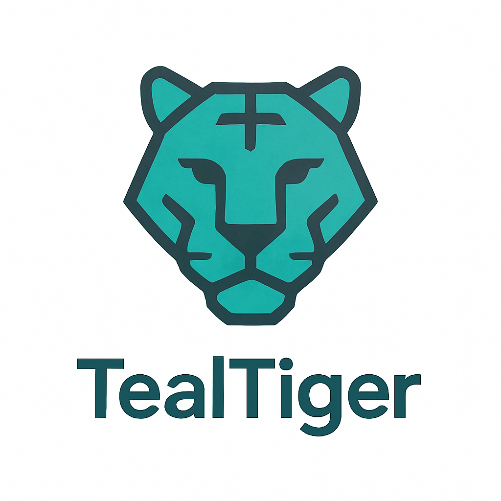

<div align="center">
  <picture>
    <source media="(prefers-color-scheme: dark)" srcset=".github/logo/tealtiger-logo-dark.png">
    <source media="(prefers-color-scheme: light)" srcset=".github/logo/tealtiger-logo-light.png">
    
  </picture>
  
  # TealTiger Python SDK

  > The first open-source AI agent security SDK with **client-side guardrails** 🛡️

  [](https://pypi.org/project/tealtiger/)
  [](https://pypi.org/project/tealtiger/)
  [](https://github.com/agentguard-ai/tealtiger-python-prod/actions/workflows/test.yml)
  [](https://opensource.org/licenses/Apache-2.0)
  [](https://docs.tealtiger.ai)
  [](https://discord.gg/X2ePf8QAj)
</div>

> 📖 **[Read the introduction blog post](https://dev.to/nagasatish_chilakamarti_2/introducing-tealtiger-ai-security-cost-control-made-simple-4lma)** | 📚 **[Documentation](https://docs.tealtiger.ai)**

## What's New in v1.7.0

**`TealEngine` governs one thing, verifiably.** Tool-allowlist policy is now enforced: a
tool configured `{"allowed": False}` comes back `DENY`, and a tool nobody configured
comes back `DENY` too, because default-deny is normative. Verified **16/16** against the
shared [conformance corpus](https://github.com/agentguard-ai/tealtiger-conformance) in CI
on every build, 11/11 of them cases that expect a denial.

- **`Decision.triggering_clause`** names the clause that produced each decision, for
  example `tools.file_delete.allowed`. It is what distinguishes a real verdict from a
  coincidence, and a decision that is not `ALLOW` cannot be constructed without one.
- **A policy configuring a rule type this SDK does not implement is refused**, not
  partially honoured. Enforcing the half we understand and ignoring the rest would return
  an `ALLOW` the policy did not earn. `TealEngine.rule_type_support()` publishes the claim
  per rule type; `engine.unenforceable_sections()` answers it for your policy at startup.
- **A conformance gate in CI**, running the shared corpus against every push and pull
  request, reporting the build it tested and refusing to score one it cannot identify.
- **ASI02 (Tool Misuse) moves to 🟢 Full** on that evidence — see
  [the table](#-owasp-top-10-for-agentic-applications-coverage) for the standard applied
  and why the number has moved twice.

Not a breaking change for working code: 1.6.0 raised for every policy, so no caller was
receiving a decision to depend on. Note that an empty policy now **allows** rather than
raising, which is specified behaviour — a policy that configures nothing has nothing to
enforce.

Earlier releases are in the
[changelog](https://github.com/agentguard-ai/tealtiger-python-prod/blob/main/CHANGELOG.md),
including 1.6.0's removal of the silent-allow defect that this release builds on.

## Observe Mode (Zero-Config Adoption)

**`observe()` — one line to instrument any LLM client** with full visibility and an instant kill switch:

- **`observe(client)`** — Zero-config proxy wrapping for any of 12 supported LLM providers
- **Automatic Cost Tracking** — Per-request, per-session, per-agent cost accumulation across all providers
- **Behavioral Baseline** — Statistical profiling (P50/P95/P99 latency, token distribution, cost patterns)
- **PII Detection (REPORT_ONLY)** — Passive PII scanning without blocking — visibility before enforcement
- **`freeze()` / `unfreeze()`** — Instant kill switch to halt any agent immediately, zero policy required
- **Structured Audit Trail** — Every call logged with correlation IDs, cost, latency, and governance metadata
- **Governance Dashboard** — Real-time overview with KPI metrics, defense pipeline, canary alerts, agent matrix
- **Under 5ms overhead** — All instrumentation is in-process, deterministic, and offline-capable

```bash
pip install tealtiger
```

## 🚀 Quick Start

```bash
pip install tealtiger
```

```python
import asyncio
from tealtiger import TealOpenAI, GuardrailEngine, PIIDetectionGuardrail, PromptInjectionGuardrail

async def main():
    # Set up guardrails
    engine = GuardrailEngine()
    engine.register_guardrail(PIIDetectionGuardrail())
    engine.register_guardrail(PromptInjectionGuardrail())

    # Create guarded client — drop-in replacement for OpenAI
    client = TealOpenAI(
        api_key="your-openai-key",
        agent_id="my-agent",
        guardrail_engine=engine
    )

    response = await client.chat.completions.create(
        model="gpt-4",
        messages=[{"role": "user", "content": "Hello!"}]
    )

    print(response.choices[0].message.content)
    print(f"Guardrails passed: {response.security.guardrail_result.passed}")

asyncio.run(main())
```

## 🌐 Supported Providers

Three clients are importable from the package root; the rest import from
`tealtiger.clients`.

| Provider | Client | Import from | Models |
|----------|--------|-------------|--------|
| **OpenAI** | `TealOpenAI` | `tealtiger` | GPT-4, GPT-3.5 Turbo |
| **Anthropic** | `TealAnthropic` | `tealtiger` | Claude 3, Claude 2 |
| **Azure** | `TealAzureOpenAI` | `tealtiger` | GPT-4, GPT-3.5 |
| **Google** | `TealGemini` | `tealtiger.clients` | Gemini Pro, Ultra |
| **AWS** | `TealBedrock` | `tealtiger.clients` | Claude, Titan, Jurassic, Command, Llama |
| **Cohere** | `TealCohere` | `tealtiger.clients` | Command, Embed |
| **Mistral** | `TealMistral` | ⚠️ see note | Large, Medium, Small, Mixtral |

```python
from tealtiger import TealOpenAI
from tealtiger.clients import TealGemini
```

> ⚠️ **`TealMistral` is currently broken.** It imports the `mistralai` v0.x API
> (`from mistralai.client import MistralClient`), which v1.0 removed. Because the
> dependency floor is unbounded (`mistralai>=0.1.0`), any current `mistralai`
> install raises `ImportError`. Tracked separately — do not rely on this client
> until it is ported to the v1 API.

## 🛡️ Key Features

### TealEngine — Policy Evaluation

**Tool allowlist is enforced. Nothing else is.** That distinction is maintained in the
code rather than left to this README: a policy configuring any other rule type is
**refused**, not partially honoured.

| Rule type | Status |
|---|---|
| `tools` | ✅ **enforced** — specified, implemented, and verified 16/16 against the shared [conformance corpus](https://github.com/agentguard-ai/tealtiger-conformance) on every build |
| content, code execution, cost, rate limiting, memory, identity, behavioral | ❌ **unspecified** — the conformance specification defines none of these in v0.1, so none is implemented and none is claimed |

```python
from tealtiger import TealEngine
from tealtiger.core.engine import ModeConfig, PolicyMode

engine = TealEngine(
    policies={"tools": {"search": {"allowed": True},
                        "file_delete": {"allowed": False}}},
    mode=ModeConfig(default=PolicyMode.ENFORCE),
)

decision = engine.evaluate_with_mode({
    "agentId": "agent-001",
    "action": "tool.execute",
    "tool": "file_delete",
})

decision.action              # DecisionAction.DENY
decision.reason_codes        # [POLICY_VIOLATION, TOOL_NOT_ALLOWED]
decision.triggering_clause   # 'tools.file_delete.allowed'
```

**`triggering_clause` is the field to pay attention to.** It names the clause that
produced the decision, which is what lets you tell a real verdict from a coincidence. A
tool nobody configured is denied as `tools.<name>.absent`, not `tools.<name>.allowed` —
same action, same reason codes, different policy fact, and an operator needs to tell
"nobody configured this" from "somebody forbade this".

**Default-deny is normative.** An unknown tool is not an allowed tool. `tools: {}` is an
allowlist that permits nothing, and is deliberately not the same as omitting the section,
which configures no tool policy at all. The only way to opt out is an explicit `"*"`
fallback entry, which is attributed as `tools.*.allowed` so a blanket permit is visible
in the decision rather than indistinguishable from a specific rule.

**Modes** follow §5.4 of the specification. `ENFORCE` returns the decision unmodified.
`MONITOR` evaluates fully and then allows, while preserving the reason codes and the
clause, so a rollout can learn what *would* break without breaking it. `REPORT_ONLY`
skips evaluation entirely and says so.

```python
# Find out at startup, not on the first denial that mattered.
TealEngine.rule_type_support()        # {'tools': 'enforced', 'content': 'unspecified', ...}
engine.unenforceable_sections()       # () when this engine's policy is fully enforceable
```

> **History, kept because the claim matters.** Until 1.6.0 this class returned ALLOW for
> every request without reading the policy at all — a tool configured
> `{"allowed": False}` was permitted, as were prompt injection, PII,
> `os.system('rm -rf /')` and any cost above any limit, while the decision reported
> `POLICY_COMPLIANT` with a risk score of 0. 1.6.0 replaced that silent allow with a loud
> `NotImplementedError`. This release replaces the failure with a real decision for the
> one rule type the specification defines, and keeps the failure for the ones it does not.

For content governance use the guardrails below. For provider instrumentation and cost
tracking use `observe()`; for a kill switch use `freeze()`; for failure isolation use
`TealCircuit`. The TypeScript SDK implements more rule types and is scored against the
same corpus.

### TealGuard — Security Guardrails

Client-side guardrails that run in milliseconds with no server dependency:

```python
from tealtiger import GuardrailEngine, PIIDetectionGuardrail, PromptInjectionGuardrail, ContentModerationGuardrail

engine = GuardrailEngine(parallel_execution=True, timeout=5000)

engine.register_guardrail(PIIDetectionGuardrail(action="redact"))
engine.register_guardrail(PromptInjectionGuardrail(sensitivity="high"))
engine.register_guardrail(ContentModerationGuardrail(threshold=0.7))

result = await engine.execute(user_input)
print(f"Passed: {result.passed}")
print(f"Risk Score: {result.risk_score}")
```

**Detects:** PII (emails, phones, SSNs, credit cards, IBANs, passport numbers), prompt injection, jailbreaks, harmful content, custom patterns.

### TealCircuit — Circuit Breaker

Cascading failure prevention with automatic failover:

```python
from tealtiger import TealCircuit

circuit = TealCircuit(
    failure_threshold=5,      # consecutive failures before opening
    timeout=30000,            # ms to wait before attempting to close
    half_open_requests=3      # successes in half-open before closing
)

# Wraps provider calls with circuit breaker protection
response = await circuit.execute(
    lambda: client.chat.completions.create(model="gpt-4", messages=messages)
)
```

### TealAudit — Audit Logging & Redaction

Versioned audit events with security-by-default PII redaction:

```python
from tealtiger import TealAudit, RedactionLevel
from tealtiger.core.audit.teal_audit import AuditConfig, ConsoleOutput

audit = TealAudit(
    outputs=[ConsoleOutput()],   # or CustomOutput for your own sink
    config=AuditConfig(
        input_redaction=RedactionLevel.HASH,    # SHA-256 hash + size (default)
        output_redaction=RedactionLevel.HASH,
        detect_pii=True,
        debug_mode=False,
    ),
)
```

**Redaction levels:** HASH (default, production-safe), SIZE_ONLY, CATEGORY_ONLY, FULL, NONE (debug only).

### Correlation IDs & Traceability

End-to-end request tracking across all components:

```python
from tealtiger import ContextManager, ExecutionContextOptions

context = ContextManager.create_context(ExecutionContextOptions(
    tenant_id="acme-corp",
    application="customer-support",   # not `app`
    environment="production",         # not `env`
))

# Context propagates through TealEngine, TealAudit, and all providers
response = await client.chat.completions.create(
    model="gpt-4",
    messages=[{"role": "user", "content": "Hello"}],
    context=context
)

# Query audit logs by correlation_id
events = await audit.query(correlation_id=context.correlation_id)
```

**Features:** Auto-generated UUID v4 correlation IDs, OpenTelemetry-compatible trace IDs, HTTP header propagation, multi-tenant support.

### Policy Test Harness

Validate policy behavior before production deployment:

> **Use `PolicyTestRunner`, not `PolicyTester`.** `PolicyTester` is a deprecated
> placeholder that never evaluated anything — as of v1.5.0 it raises
> `NotImplementedError` rather than returning a misleading `allow`.

```python
from tealtiger import PolicyTestRunner, TestCorpora

tester = PolicyTestRunner(engine)
report = tester.run_suite({
    "name": "Customer Support Policy Tests",
    "tests": [
        {
            "name": "Block file deletion",
            "context": {"agent_id": "support-001", "action": "tool.execute", "tool": "file_delete"},
            "expected": {"action": DecisionAction.DENY, "reason_codes": [ReasonCode.TOOL_NOT_ALLOWED]}
        },
        *TestCorpora.prompt_injection(),
        *TestCorpora.pii_detection()
    ]
})

print(f"Tests: {report.passed}/{report.total} passed")
```

```bash
# CLI usage
python -m tealtiger.cli.test ./policies/*.test.json --coverage --format=junit --output=./results.xml
```

### Cost Tracking & Budget Management

Track costs across 49 models and enforce spending limits:

```python
from tealtiger import CostTracker, BudgetManager, InMemoryCostStorage, TokenUsage

storage = InMemoryCostStorage()
tracker = CostTracker()
budget_manager = BudgetManager(storage)

budget_manager.create_budget({
    "name": "Daily GPT-4 Budget",
    "limit": 10.0,
    "period": "daily",
    "alert_thresholds": [50, 75, 90, 100],
    "action": "block",
    "enabled": True
})

# Estimate before request — takes a TokenUsage, not a dict
estimate = tracker.estimate_cost(
    "gpt-4",
    TokenUsage(input_tokens=1000, output_tokens=500, total_tokens=1500),
    "openai",
)

# Check budget
check = await budget_manager.check_budget("agent-123", estimate)
if not check.allowed:
    print(f"Blocked by: {check.blocked_by.name}")
```

## 🛡️ OWASP Top 10 for Agentic Applications Coverage

This SDK provides **full coverage of 3 of 10** OWASP ASI categories, partial or supporting
coverage of 3 more, and does not address the remaining 4.

The standard applied: a row is marked 🟢 **Full** only where the capability is specified,
implemented, **and** demonstrated by a conformance suite. That is a higher bar than this
table used before 2026-11, and it is why the number has moved twice.

| ASI | Vulnerability | Coverage | Components |
|-----|--------------|----------|------------|
| ASI01 | Goal Hijacking & Prompt Injection | 🟡 Partial | TealGuard |
| ASI02 | Tool Misuse & Unauthorized Actions | 🟢 Full | TealEngine |
| ASI03 | Identity & Access Control Failures | ❌ Not implemented | — |
| ASI04 | Supply Chain Vulnerabilities | 🔧 Support | TealAudit |
| ASI05 | Unsafe Code Execution | ❌ Not implemented | — |
| ASI06 | Memory & Context Corruption | ❌ Not implemented | — |
| ASI07 | Inter-Agent Communication Security | ❌ Platform | N/A |
| ASI08 | Cascading Failures & Resource Exhaustion | 🟢 Full | TealCircuit |
| ASI09 | Harmful Content Generation | 🔧 Support | TealGuard |
| ASI10 | Rogue Agent Behavior | 🟢 Full | TealAudit |

Notes on the rows that have moved, so the reasoning is checkable:

- **ASI02 → 🟢 Full.** Tool-allowlist enforcement is specified (conformance spec §6,
  TA-1 through TA-8), implemented in this SDK, and verified **16/16** against the shared
  corpus in CI on every build, including 11/11 of the cases that expect a denial. This is
  the same evidence standard the TypeScript SDK's ASI02 row rests on, and the row was
  marked Not implemented until that evidence existed.
- **ASI01** stays 🟡 Partial on the strength of the prompt-injection guardrail.
  `TealEngine` is not credited: its content clause is unspecified and unimplemented.
- **ASI03 and ASI05** stay ❌. Identity and code-execution rule types are UNSPECIFIED in
  conformance spec v0.1 §7, so there is nothing to implement against yet. A policy
  configuring either is refused rather than quietly passed.
- **ASI06** stays ❌. This SDK has PII and secret *detectors* but no memory policy
  engine, no memory decision actions, and no `TealMemory` export.

> **Revision history for this table.** Before 2026-11 it claimed "7 out of 10", with
> 🟢 Full coverage of ASI02, ASI03 and ASI05 attributed to a `TealEngine` that evaluated
> nothing. That was corrected to 2 of 10 when the engine was measured. ASI02 returns to
> Full here on evidence rather than assertion. The three rows that were never in dispute
> — ASI08, ASI09, ASI10 — have not changed throughout.

📖 [OWASP Top 10 for Agentic Applications](https://owasp.org/www-project-top-10-for-agentic-applications/)

## 🎯 Use Cases

- **Customer Support Bots** — Protect customer PII
- **Healthcare AI** — HIPAA compliance
- **Financial Services** — Prevent data leakage
- **E-commerce** — Secure payment information
- **Enterprise AI** — Policy enforcement and audit trails
- **Education Platforms** — Content safety

## 📚 Documentation

- [Full Documentation](https://docs.tealtiger.ai)
- [API Reference](https://docs.tealtiger.ai/api)
- [Examples](https://github.com/agentguard-ai/tealtiger-python-prod/tree/main/examples)
- [Changelog](https://github.com/agentguard-ai/tealtiger-python-prod/blob/main/CHANGELOG.md)

## 🤝 Contributing

We welcome contributions! Please see our [Contributing Guide](https://github.com/agentguard-ai/tealtiger-python-prod/blob/main/CONTRIBUTING.md).

## 📄 License

Apache 2.0 — see [LICENSE](https://github.com/agentguard-ai/tealtiger-python-prod/blob/main/LICENSE)

## 🔗 Links

- **PyPI**: https://pypi.org/project/tealtiger/
- **GitHub (this SDK)**: https://github.com/agentguard-ai/tealtiger-python-prod
- **GitHub (monorepo)**: https://github.com/agentguard-ai/tealtiger
- **TypeScript SDK**: https://www.npmjs.com/package/tealtiger
- **Documentation**: https://docs.tealtiger.ai
- **Discord**: https://discord.gg/X2ePf8QAj
- **LinkedIn**: https://www.linkedin.com/company/tealtiger/
- **X (Twitter)**: https://x.com/TealtigerAI
- **Contact**: reachout@tealtiger.ai
- **Issues**: https://github.com/agentguard-ai/tealtiger-python-prod/issues

---

**Made with ❤️ by the TealTiger team**
