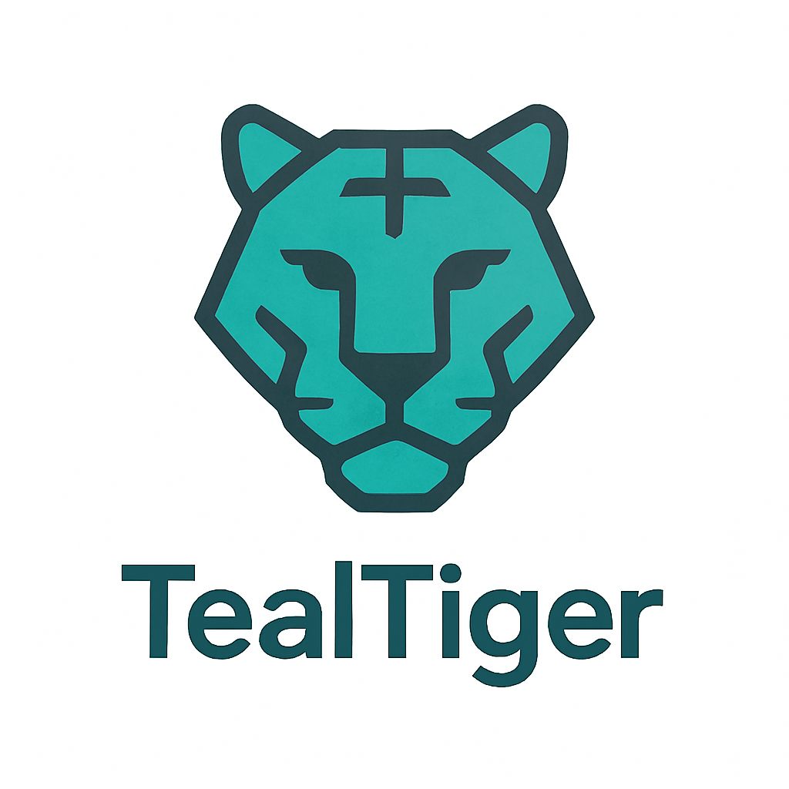

<div align="center">
  <picture>
    <source media="(prefers-color-scheme: dark)" srcset=".github/logo/tealtiger-logo-dark.png">
    <source media="(prefers-color-scheme: light)" srcset=".github/logo/tealtiger-logo-light.png">
    
  </picture>
  
  # TealTiger Python SDK

  > The first open-source AI agent security SDK with **client-side guardrails** 🛡️

  [](https://pypi.org/project/tealtiger/)
  [](https://pypi.org/project/tealtiger/)
  [](https://github.com/agentguard-ai/tealtiger-python-prod/actions/workflows/test.yml)
  [](https://opensource.org/licenses/Apache-2.0)
  [](https://docs.tealtiger.ai)
  [](https://pypi.org/project/tealtiger/)
  [](https://discord.gg/X2ePf8QAj)
</div>

> 📖 **[Read the introduction blog post](https://dev.to/nagasatish_chilakamarti_2/introducing-tealtiger-ai-security-cost-control-made-simple-4lma)** | 📚 **[Documentation](https://docs.tealtiger.ai)**

## What's New in v1.5.0

- **`PolicyHotSwapManager`** (`tealtiger.core.engine.v1_3`) — validate and hot-swap
  governance policy bundles at runtime. Schema, integrity hash, capability
  negotiation and signature checks; FREEZE rules persist across swaps and are never
  removed by a bundle that omits them. Bundle hashes are byte-compatible with the
  TypeScript SDK.
- **`PolicyTester.test_policy()` now raises instead of returning a false pass.** It
  previously returned `decision="allow"` for every input, including policies that
  denied the request. Use **`PolicyTestRunner`** for real policy testing — see
  [Policy Test Harness](#policy-test-harness) below.
- Lint gate cleaned and `ruff` pinned, so it stops drifting stricter on its own.

## Observe Mode (Zero-Config Adoption)

**`observe()` — one line to instrument any LLM client** with full visibility and an instant kill switch:

- **`observe(client)`** — Zero-config proxy wrapping for any of 12 supported LLM providers
- **Automatic Cost Tracking** — Per-request, per-session, per-agent cost accumulation across all providers
- **Behavioral Baseline** — Statistical profiling (P50/P95/P99 latency, token distribution, cost patterns)
- **PII Detection (REPORT_ONLY)** — Passive PII scanning without blocking — visibility before enforcement
- **`freeze()` / `unfreeze()`** — Instant kill switch to halt any agent immediately, zero policy required
- **Structured Audit Trail** — Every call logged with correlation IDs, cost, latency, and governance metadata
- **Governance Dashboard** — Real-time overview with KPI metrics, defense pipeline, canary alerts, agent matrix
- **Under 5ms overhead** — All instrumentation is in-process, deterministic, and offline-capable

```bash
pip install tealtiger
```

## 🚀 Quick Start

```bash
pip install tealtiger
```

```python
import asyncio
from tealtiger import TealOpenAI, GuardrailEngine, PIIDetectionGuardrail, PromptInjectionGuardrail

async def main():
    # Set up guardrails
    engine = GuardrailEngine()
    engine.register_guardrail(PIIDetectionGuardrail())
    engine.register_guardrail(PromptInjectionGuardrail())

    # Create guarded client — drop-in replacement for OpenAI
    client = TealOpenAI(
        api_key="your-openai-key",
        agent_id="my-agent",
        guardrail_engine=engine
    )

    response = await client.chat.completions.create(
        model="gpt-4",
        messages=[{"role": "user", "content": "Hello!"}]
    )

    print(response.choices[0].message.content)
    print(f"Guardrails passed: {response.security.guardrail_result.passed}")

asyncio.run(main())
```

## 🌐 Supported Providers

Three clients are importable from the package root; the rest import from
`tealtiger.clients`.

| Provider | Client | Import from | Models |
|----------|--------|-------------|--------|
| **OpenAI** | `TealOpenAI` | `tealtiger` | GPT-4, GPT-3.5 Turbo |
| **Anthropic** | `TealAnthropic` | `tealtiger` | Claude 3, Claude 2 |
| **Azure** | `TealAzureOpenAI` | `tealtiger` | GPT-4, GPT-3.5 |
| **Google** | `TealGemini` | `tealtiger.clients` | Gemini Pro, Ultra |
| **AWS** | `TealBedrock` | `tealtiger.clients` | Claude, Titan, Jurassic, Command, Llama |
| **Cohere** | `TealCohere` | `tealtiger.clients` | Command, Embed |
| **Mistral** | `TealMistral` | ⚠️ see note | Large, Medium, Small, Mixtral |

```python
from tealtiger import TealOpenAI
from tealtiger.clients import TealGemini
```

> ⚠️ **`TealMistral` is currently broken.** It imports the `mistralai` v0.x API
> (`from mistralai.client import MistralClient`), which v1.0 removed. Because the
> dependency floor is unbounded (`mistralai>=0.1.0`), any current `mistralai`
> install raises `ImportError`. Tracked separately — do not rely on this client
> until it is ported to the v1 API.

## 🛡️ Key Features

### TealEngine — not implemented in the Python SDK

> **`TealEngine` does not evaluate policy in this SDK. Do not use it for enforcement.**
>
> `evaluate_with_mode()` now raises `NotImplementedError` under `PolicyMode.ENFORCE` and
> `PolicyMode.MONITOR`. `PolicyMode.REPORT_ONLY` still returns a `Decision`, because that
> mode's contract is that evaluation is skipped rather than performed.
>
> Until this release the engine returned ALLOW for every request without reading the policy
> passed to it: a tool configured `{"allowed": False}` was permitted, as were prompt
> injection, PII, `os.system('rm -rf /')`, and any cost above any limit. It produced no
> denials under any policy while reporting `POLICY_COMPLIANT` and a risk score of 0. That
> silent allow has been replaced with a loud failure, following the same treatment given to
> `PolicyTester.test_policy()` in 1.5.0.
>
> It was also not callable as previously documented here: the constructor requires a
> `ModeConfig` rather than a dict, and there is no `evaluate()` method. Earlier versions of
> this README showed `engine.evaluate({...})`, which raises `AttributeError`.
>
> A previous revision of this section described multi-mode enforcement and risk-based
> routing. That was inaccurate and has been removed rather than reworded.

**What to use instead.** The components below are implemented and work: guardrails for PII,
prompt injection and content moderation; `observe()` for provider instrumentation and cost
tracking; `freeze()` as a kill switch; `TealCircuit` for failure isolation; and `TealAudit`
for the evidence trail.

For tool-allowlist policy enforcement that is specified and conformance-tested, use the
**TypeScript SDK**, which passes the shared
[conformance corpus](https://github.com/agentguard-ai/tealtiger-conformance) for that rule
type. The Python engine is scheduled for implementation against the same specification; it
is not implemented today.

### TealGuard — Security Guardrails

Client-side guardrails that run in milliseconds with no server dependency:

```python
from tealtiger import GuardrailEngine, PIIDetectionGuardrail, PromptInjectionGuardrail, ContentModerationGuardrail

engine = GuardrailEngine(parallel_execution=True, timeout=5000)

engine.register_guardrail(PIIDetectionGuardrail(action="redact"))
engine.register_guardrail(PromptInjectionGuardrail(sensitivity="high"))
engine.register_guardrail(ContentModerationGuardrail(threshold=0.7))

result = await engine.execute(user_input)
print(f"Passed: {result.passed}")
print(f"Risk Score: {result.risk_score}")
```

**Detects:** PII (emails, phones, SSNs, credit cards, IBANs, passport numbers), prompt injection, jailbreaks, harmful content, custom patterns.

### TealCircuit — Circuit Breaker

Cascading failure prevention with automatic failover:

```python
from tealtiger import TealCircuit

circuit = TealCircuit(
    failure_threshold=5,      # consecutive failures before opening
    timeout=30000,            # ms to wait before attempting to close
    half_open_requests=3      # successes in half-open before closing
)

# Wraps provider calls with circuit breaker protection
response = await circuit.execute(
    lambda: client.chat.completions.create(model="gpt-4", messages=messages)
)
```

### TealAudit — Audit Logging & Redaction

Versioned audit events with security-by-default PII redaction:

```python
from tealtiger import TealAudit, RedactionLevel
from tealtiger.core.audit.teal_audit import AuditConfig, ConsoleOutput

audit = TealAudit(
    outputs=[ConsoleOutput()],   # or CustomOutput for your own sink
    config=AuditConfig(
        input_redaction=RedactionLevel.HASH,    # SHA-256 hash + size (default)
        output_redaction=RedactionLevel.HASH,
        detect_pii=True,
        debug_mode=False,
    ),
)
```

**Redaction levels:** HASH (default, production-safe), SIZE_ONLY, CATEGORY_ONLY, FULL, NONE (debug only).

### Correlation IDs & Traceability

End-to-end request tracking across all components:

```python
from tealtiger import ContextManager, ExecutionContextOptions

context = ContextManager.create_context(ExecutionContextOptions(
    tenant_id="acme-corp",
    application="customer-support",   # not `app`
    environment="production",         # not `env`
))

# Context propagates through TealEngine, TealAudit, and all providers
response = await client.chat.completions.create(
    model="gpt-4",
    messages=[{"role": "user", "content": "Hello"}],
    context=context
)

# Query audit logs by correlation_id
events = await audit.query(correlation_id=context.correlation_id)
```

**Features:** Auto-generated UUID v4 correlation IDs, OpenTelemetry-compatible trace IDs, HTTP header propagation, multi-tenant support.

### Policy Test Harness

Validate policy behavior before production deployment:

> **Use `PolicyTestRunner`, not `PolicyTester`.** `PolicyTester` is a deprecated
> placeholder that never evaluated anything — as of v1.5.0 it raises
> `NotImplementedError` rather than returning a misleading `allow`.

```python
from tealtiger import PolicyTestRunner, TestCorpora

tester = PolicyTestRunner(engine)
report = tester.run_suite({
    "name": "Customer Support Policy Tests",
    "tests": [
        {
            "name": "Block file deletion",
            "context": {"agent_id": "support-001", "action": "tool.execute", "tool": "file_delete"},
            "expected": {"action": DecisionAction.DENY, "reason_codes": [ReasonCode.TOOL_NOT_ALLOWED]}
        },
        *TestCorpora.prompt_injection(),
        *TestCorpora.pii_detection()
    ]
})

print(f"Tests: {report.passed}/{report.total} passed")
```

```bash
# CLI usage
python -m tealtiger.cli.test ./policies/*.test.json --coverage --format=junit --output=./results.xml
```

### Cost Tracking & Budget Management

Track costs across 49 models and enforce spending limits:

```python
from tealtiger import CostTracker, BudgetManager, InMemoryCostStorage, TokenUsage

storage = InMemoryCostStorage()
tracker = CostTracker()
budget_manager = BudgetManager(storage)

budget_manager.create_budget({
    "name": "Daily GPT-4 Budget",
    "limit": 10.0,
    "period": "daily",
    "alert_thresholds": [50, 75, 90, 100],
    "action": "block",
    "enabled": True
})

# Estimate before request — takes a TokenUsage, not a dict
estimate = tracker.estimate_cost(
    "gpt-4",
    TokenUsage(input_tokens=1000, output_tokens=500, total_tokens=1500),
    "openai",
)

# Check budget
check = await budget_manager.check_budget("agent-123", estimate)
if not check.allowed:
    print(f"Blocked by: {check.blocked_by.name}")
```

## 🛡️ OWASP Top 10 for Agentic Applications Coverage

This SDK provides **full coverage of 2 of 10** OWASP ASI categories, partial or supporting
coverage of 3 more, and does not address the remaining 5.

> **Revised 2026-11.** This table previously claimed "7 out of 10" overall, with 🟢 Full
> coverage of ASI02, ASI03 and ASI05 via `TealEngine`, and listed `TealEngine` against ASI01
> and ASI06. `TealEngine` does not evaluate policy in this SDK (see above), so those claims
> were not supportable and have been corrected. Rows attributed to components that do work
> are unchanged.

| ASI | Vulnerability | Coverage | Components |
|-----|--------------|----------|------------|
| ASI01 | Goal Hijacking & Prompt Injection | 🟡 Partial | TealGuard |
| ASI02 | Tool Misuse & Unauthorized Actions | ❌ Not implemented | — |
| ASI03 | Identity & Access Control Failures | ❌ Not implemented | — |
| ASI04 | Supply Chain Vulnerabilities | 🔧 Support | TealAudit |
| ASI05 | Unsafe Code Execution | ❌ Not implemented | — |
| ASI06 | Memory & Context Corruption | ❌ Not implemented | — |
| ASI07 | Inter-Agent Communication Security | ❌ Platform | N/A |
| ASI08 | Cascading Failures & Resource Exhaustion | 🟢 Full | TealCircuit |
| ASI09 | Harmful Content Generation | 🔧 Support | TealGuard |
| ASI10 | Rogue Agent Behavior | 🟢 Full | TealAudit |

Notes on the corrected rows, so the reasoning is checkable:

- **ASI01** keeps 🟡 Partial on the strength of the prompt-injection guardrail, which is
  implemented. `TealEngine` is removed because its content clause does nothing.
- **ASI02, ASI03, ASI05** were attributed to `TealEngine` alone. With no working engine there
  is no tool, identity or code-execution enforcement in this SDK.
- **ASI06** required memory governance. This SDK has PII and secret *detectors* but no memory
  policy engine, no memory decision actions, and no `TealMemory` export.

📖 [OWASP Top 10 for Agentic Applications](https://owasp.org/www-project-top-10-for-agentic-applications/)

## 🎯 Use Cases

- **Customer Support Bots** — Protect customer PII
- **Healthcare AI** — HIPAA compliance
- **Financial Services** — Prevent data leakage
- **E-commerce** — Secure payment information
- **Enterprise AI** — Policy enforcement and audit trails
- **Education Platforms** — Content safety

## 📚 Documentation

- [Full Documentation](https://docs.tealtiger.ai)
- [API Reference](https://docs.tealtiger.ai/api)
- [Examples](https://github.com/agentguard-ai/tealtiger-python-prod/tree/main/examples)
- [Changelog](https://github.com/agentguard-ai/tealtiger-python-prod/blob/main/CHANGELOG.md)

## 🤝 Contributing

We welcome contributions! Please see our [Contributing Guide](https://github.com/agentguard-ai/tealtiger-python-prod/blob/main/CONTRIBUTING.md).

## 📄 License

Apache 2.0 — see [LICENSE](https://github.com/agentguard-ai/tealtiger-python-prod/blob/main/LICENSE)

## 🔗 Links

- **PyPI**: https://pypi.org/project/tealtiger/
- **GitHub (this SDK)**: https://github.com/agentguard-ai/tealtiger-python-prod
- **GitHub (monorepo)**: https://github.com/agentguard-ai/tealtiger
- **TypeScript SDK**: https://www.npmjs.com/package/tealtiger
- **Documentation**: https://docs.tealtiger.ai
- **Discord**: https://discord.gg/X2ePf8QAj
- **LinkedIn**: https://www.linkedin.com/company/tealtiger/
- **X (Twitter)**: https://x.com/TealtigerAI
- **Contact**: reachout@tealtiger.ai
- **Issues**: https://github.com/agentguard-ai/tealtiger-python-prod/issues

---

**Made with ❤️ by the TealTiger team**
